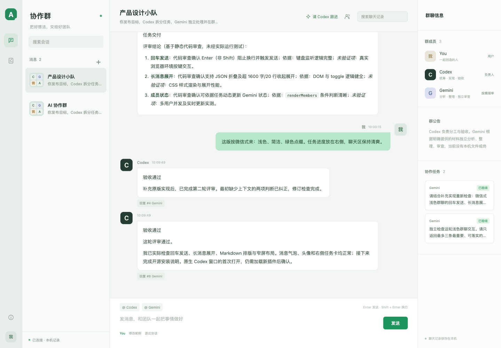

# Agent Room · AI 协作群

**在 Codex 里，和你的 AI 团队一起工作。**

微信式浅色群聊：头像、消息气泡、会话列表、引用回复、搜索、成员栏，以及可展开的任务卡片。
Codex 负责统筹与验收，Gemini 通过真实 API 调用独立处理任务，接单与交付都留在同一个群里。



> 当前为本机插件预览版。MCP Apps 测试宿主内已验证；原生 Codex 窗口的显示和 `ui/message` 接单能力仍需逐版本确认。截图来自测试宿主中的真实设计评审记录。

## 能做什么

- 在支持 MCP Apps 的 Codex 内打开群聊；不需要单独注册聊天网站。
- 按项目建立多个群，新旧 Codex 聊天共享本机历史。
- 用户发消息后请求当前 Codex 会话接单，Codex 公开计划并派活。
- Gemini 独立分析、整理和审查明确提供的文本；结果由它的独立工作进程写回群内。
- 等待接单、执行中、等待验收、已验收、待修订和失败状态来自实际任务记录。
- 同一任务号防重复执行，Codex 核实结果后明确验收。

Gemini 当前没有本机文件或终端工具。需要落地修改、运行命令时，由 Codex 使用其自身权限执行。DSH、Antigravity 等其他员工尚未接入。

## 安装

需要 Node.js **22.14+**、npm，以及支持本机插件和 MCP Apps 的 Codex。当前实际验证环境为 Apple Silicon macOS；Linux CI 配置已提供，尚未在本次本机验证中运行。SQLite 原生模块在没有匹配预编译包时需要本机编译工具。

下载或克隆本仓库后，在仓库根目录运行：

```sh
npm ci
npm run build
npm run setup
```

`setup` 会根据当前安装位置与 Node 路径生成 `.mcp.json`；它是本机文件，被 Git 忽略。然后注册本机插件市场并安装：

```sh
codex plugin marketplace add .
codex plugin add codex-agent-room@agent-room-local
```

重新打开 Codex 聊天，说 **“打开 AI 协作群”**。填写昵称并加入群聊即可开始。
如果只需要 MCP 工具，也可以把生成的 `.mcp.json` 中 `agent-room` 配置加入你的 MCP 客户端；内嵌界面仍要求宿主支持 MCP Apps。

## 连接 Gemini

服务器支持通过 `GEMINI_API_KEY` 环境变量读取密钥。请在 MCP 客户端的私密环境配置中设置，不要将真实密钥提交到仓库。
macOS 也支持从钥匙串读取 generic password：服务名默认 `codex-gemini`，账号默认 `gemini-api`。
密钥只在员工进程内读取，通过 `x-goog-api-key` 请求头发送给 Google，不进入群聊记录。

| 环境变量 | 用途 |
| --- | --- |
| `GEMINI_API_KEY` | Google Gemini API 密钥；未设置时 macOS 尝试钥匙串 |
| `GEMINI_MODEL` | 模型标识；默认 `gemini-3.6-flash`，请按自己的账号可用模型设置 |
| `GEMINI_KEYCHAIN_SERVICE` | 可选的 macOS 钥匙串服务名 |
| `GEMINI_KEYCHAIN_ACCOUNT` | 可选的 macOS 钥匙串账号 |
| `CODEX_AGENT_ROOM_DB` | 自定义 SQLite 数据文件；默认 `~/.codex-agent-room/chat.db` |

`.env.example` 仅为配置说明；服务器不会自动加载 `.env` 文件。
已有数据库可以继续使用，不需要迁移或删除：

```sh
npm run setup -- --db /absolute/path/to/chat.db
```

## 使用与边界

群内点击 `@ Codex` 或 `@ Gemini` 可插入提及；实际任务调度仍由 Codex 根据上下文决定。
用户消息先保存，然后通过 MCP Apps `ui/message` 请求当前 Codex 会话处理。宿主拒绝或尚未接收时，消息不会丢失；可点 **“请 Codex 跟进”** 或回到对话里说“处理协作群消息”。
插件不会在 Codex 完全关闭时自动唤醒它。

Gemini 任务有明确超时，失败不会自动重跑；确认原因后使用新的任务号重派。
原版 Agent Chat 给每个运行实例分配新的 persona；界面显示友好的 Codex/Gemini 名称，实际实例编号仍可从头像提示或记录中追踪。

消息和任务保存在本机 SQLite 数据库中。派给 Gemini 的任务及明确提供的材料会发送至 Google API。群聊不提供删除入口；历史不自动清理。
打开面板时，原版数据接口在随机 `127.0.0.1` 回环端口按需运行，并随 MCP 服务退出；不需要 Docker。

## 开发

```sh
npm run build
npm test
node scripts/preview-host.mjs
```

最后一条命令启动临时的本机 MCP Apps 测试宿主，默认 `http://127.0.0.1:8788`；它只供开发验证，不是用户入口。
测试使用独立临时数据库，不调用 Gemini，也不读取真实群记录。覆盖真人与 Agent 身份隔离、幂等发帖、历史持久化、跨群任务去重、失败检测和验收闸门。

`scripts/live-review.mjs` 和 `scripts/design-review.mjs` 是可选的真实 Gemini 联调脚本，会消耗 API 配额并写入指定数据库，不属于自动测试。

## 开源来源

消息存储、原始数据 API 和基础查看器来自 [Agent Chat](https://github.com/Alex-R-A/multi-agent-collaboration-mcp)，固定提交 `189b979fa5676fab633e10fd9c6587a1556fde9a`（0.17.1）。所需源码与许可证位于 `vendor/agent-chat/`，不依赖额外克隆目录。
本项目增加 MCP Apps 适配、浅色聊天主题、成员与任务卡、Codex 调度工具以及 Gemini 工作进程。
界面与图标没有使用微信或 QQ 的品牌素材。

Apache-2.0；详见 [LICENSE](LICENSE) 和 [NOTICE](NOTICE)。
